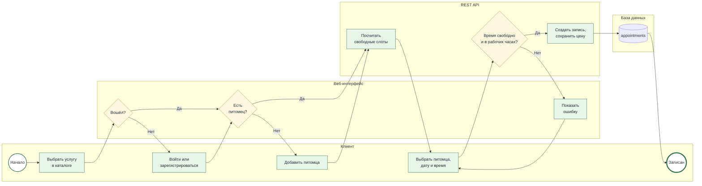
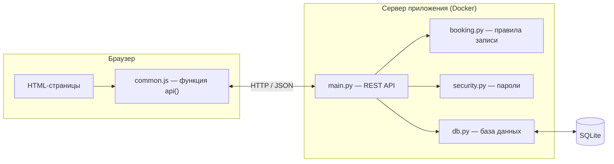
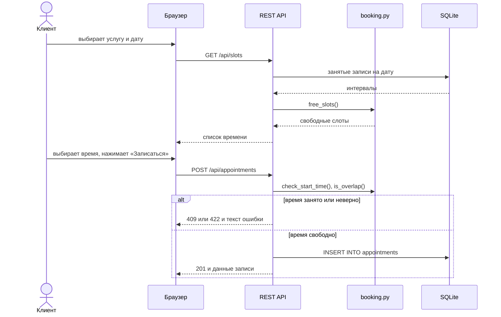

# Груминг-салон «Пушистик» — онлайн-запись питомцев на груминг

Веб-приложение для небольшого груминг-салона. Клиент выбирает услугу в каталоге, входит или регистрируется, добавляет питомца и записывается на свободное время. Администратор ведёт каталог услуг и видит расписание всего салона.

> **Статус проекта.** Реализованы аккаунты с ролями клиента и администратора и все шесть функций салона. Итоговый отчёт и инструкция по запуску доступны в разделе [Запуск](#8-запуск).
> Сервис предназначен для записи на услуги салона. Оплата онлайн и выбор конкретного мастера не входят в его задачи.

## Содержание

1. [Функциональные возможности](#1-функциональные-возможности)
2. [Диаграмма вариантов использования (Use Case)](#2-диаграмма-вариантов-использования-use-case)
3. [Диаграмма бизнес-процесса (BPMN)](#3-диаграмма-бизнес-процесса-bpmn)
4. [ER-диаграмма базы данных](#4-er-диаграмма-базы-данных)
5. [Макет интерфейса](#5-макет-интерфейса)
6. [Дополнительные диаграммы](#6-дополнительные-диаграммы)
7. [Технологии и структура проекта](#7-технологии-и-структура-проекта)
8. [Запуск](#8-запуск)

---

## 1. Функциональные возможности

| № | Функция | Описание |
|---|---------|----------|
| F1 | Аккаунт | Регистрация по email и паролю, вход и выход. Пароль хранится только в виде хеша. |
| F2 | Каталог услуг | Главная страница доступна без входа и показывает услуги с ценой и длительностью. |
| F3 | Питомцы | Клиент добавляет, изменяет и удаляет своих питомцев: кличка, вид, порода, вес. |
| F4 | Запись на услугу | Клиент выбирает услугу, питомца и дату, а система показывает только свободное время. |
| F5 | Мои записи | Клиент видит свои записи со статусами и может отменить запись не позже чем за 2 часа. |
| F6 | Администрирование | Администратор ведёт каталог услуг, видит все записи с контактами клиентов и меняет их статус. |

---

## 2. Диаграмма вариантов использования (Use Case)

### 2.1. Блок 1. Аккаунт

```mermaid
flowchart LR
    subgraph BG[" "]
        G["Гость"]
        C["Клиент"]
        A["Администратор"]
        subgraph SYS["Груминг-салон «Пушистик»"]
            UC1(["UC-1<br/>Зарегистрироваться"])
            UC2(["UC-2<br/>Войти"])
            UC3(["UC-3<br/>Выйти"])
        end
    end
    G --- UC1
    G --- UC2
    C --- UC3
    A --- UC2
    A --- UC3
    style BG fill:#000000,stroke:#000000
    style SYS fill:#0b0b0b,stroke:#9ca3af,color:#ffffff
    style G fill:#1f2937,stroke:#9ca3af,color:#ffffff
    style C fill:#1f2937,stroke:#9ca3af,color:#ffffff
    style A fill:#1f2937,stroke:#9ca3af,color:#ffffff
    linkStyle default stroke:#9ca3af,stroke-width:1.5px
```



| ID | Действие | Зачем | Что происходит |
|---|---|---|---|
| UC-1 | Зарегистрироваться | Получить доступ к записи | Сервер проверяет email, пароль и телефон, создаёт клиента и сразу выполняет вход. |
| UC-2 | Войти | Продолжить работу со своими данными | Сервер сверяет пароль с хешем и выдаёт токен сессии. |
| UC-3 | Выйти | Завершить сеанс | Токен удаляется из базы и больше не принимается. |

---

### 2.2. Блок 2. Выбор услуги и запись

```mermaid
flowchart LR
    subgraph BG[" "]
        G["Гость"]
        C["Клиент"]
        subgraph SYS["Груминг-салон «Пушистик»"]
            UC4(["UC-4<br/>Посмотреть каталог услуг"])
            UC5(["UC-5<br/>Выбрать услугу"])
            UC6(["UC-6<br/>Подобрать свободное время"])
            UC7(["UC-7<br/>Записаться"])
            UC8(["UC-8<br/>Посмотреть свои записи"])
            UC9(["UC-9<br/>Отменить запись"])
        end
    end
    G --- UC4
    G --- UC5
    C --- UC4
    C --- UC5
    C --- UC7
    C --- UC8
    C --- UC9
    UC7 -. "«include»" .-> UC6
    UC5 -. "«extend»" .-> UC7
    style BG fill:#000000,stroke:#000000
    style SYS fill:#0b0b0b,stroke:#9ca3af,color:#ffffff
    style G fill:#1f2937,stroke:#9ca3af,color:#ffffff
    style C fill:#1f2937,stroke:#9ca3af,color:#ffffff
    linkStyle default stroke:#9ca3af,stroke-width:1.5px
```



| ID | Действие | Зачем | Что происходит |
|---|---|---|---|
| UC-4 | Посмотреть каталог услуг | Узнать, что делает салон и сколько стоит | Главная страница показывает доступные услуги без входа в систему. |
| UC-5 | Выбрать услугу | Начать запись | Если пользователь не вошёл, его переносит на вход и после входа возвращает к записи. |
| UC-6 | Подобрать свободное время | Не звонить в салон | Сервер считает свободные слоты на дату с учётом длительности услуги и рабочих часов. |
| UC-7 | Записаться | Закрепить время за питомцем | Сервер проверяет время, создаёт запись и сохраняет текущую цену услуги. |
| UC-8 | Посмотреть свои записи | Помнить, когда приходить | Клиент видит только записи своих питомцев со статусами. |
| UC-9 | Отменить запись | Освободить время | Клиент может отменить запись не позже чем за 2 часа до начала. |

---

### 2.3. Блок 3. Питомцы

```mermaid
flowchart LR
    subgraph BG[" "]
        C["Клиент"]
        subgraph SYS["Груминг-салон «Пушистик»"]
            UC10(["UC-10<br/>Добавить питомца"])
            UC11(["UC-11<br/>Изменить питомца"])
            UC12(["UC-12<br/>Удалить питомца"])
        end
    end
    C --- UC10
    C --- UC11
    C --- UC12
    style BG fill:#000000,stroke:#000000
    style SYS fill:#0b0b0b,stroke:#9ca3af,color:#ffffff
    style C fill:#1f2937,stroke:#9ca3af,color:#ffffff
    linkStyle default stroke:#9ca3af,stroke-width:1.5px
```



| ID | Действие | Зачем | Что происходит |
|---|---|---|---|
| UC-10 | Добавить питомца | Записывать его на услуги | Сервер проверяет кличку, вид и вес и привязывает питомца к клиенту. |
| UC-11 | Изменить питомца | Обновить вес или породу | Изменить можно только своего питомца, чужой возвращает ошибку 404. |
| UC-12 | Удалить питомца | Убрать лишнюю карточку | Питомца с активной записью удалить нельзя, сначала нужно отменить запись. |

---

### 2.4. Блок 4. Администрирование

```mermaid
flowchart LR
    subgraph BG[" "]
        A["Администратор"]
        subgraph SYS["Груминг-салон «Пушистик»"]
            UC13(["UC-13<br/>Посмотреть все записи"])
            UC14(["UC-14<br/>Сменить статус записи"])
            UC15(["UC-15<br/>Отменить любую запись"])
            UC16(["UC-16<br/>Добавить услугу"])
            UC17(["UC-17<br/>Изменить услугу"])
            UC18(["UC-18<br/>Отключить услугу"])
            UC19(["UC-19<br/>Удалить услугу"])
        end
    end
    A --- UC13
    A --- UC14
    A --- UC15
    A --- UC16
    A --- UC17
    A --- UC19
    UC18 -. "«extend»" .-> UC17
    style BG fill:#000000,stroke:#000000
    style SYS fill:#0b0b0b,stroke:#9ca3af,color:#ffffff
    style A fill:#1f2937,stroke:#9ca3af,color:#ffffff
    linkStyle default stroke:#9ca3af,stroke-width:1.5px
```



| ID | Действие | Зачем | Что происходит |
|---|---|---|---|
| UC-13 | Посмотреть все записи | Видеть расписание салона | Таблица всех записей с именем и телефоном клиента, фильтр активных. |
| UC-14 | Сменить статус записи | Отметить выполненную работу | Статус меняется на «Записан», «Выполнено» или «Отменено». |
| UC-15 | Отменить любую запись | Освободить время по просьбе клиента | Администратор отменяет запись в любое время, без ограничения в 2 часа. |
| UC-16 | Добавить услугу | Расширить каталог | Сервер проверяет цену и длительность (кратно 30 минутам). |
| UC-17 | Изменить услугу | Поменять цену или описание | Новая цена действует только для новых записей. |
| UC-18 | Отключить услугу | Временно убрать из каталога | Услуга пропадает из каталога, старые записи на неё сохраняются. |
| UC-19 | Удалить услугу | Убрать ошибочную услугу | Услугу, на которую уже были записи, удалить нельзя, только отключить. |

---

**Описание акторов**

| Акторы | Описание |
|---|---|
| Гость | Посетитель без входа. Видит каталог услуг, может зарегистрироваться или войти. |
| Клиент | Владелец питомца. Ведёт своих питомцев, записывается и отменяет свои записи. |
| Администратор | Сотрудник салона. Ведёт каталог услуг и управляет всеми записями. |

---

## 3. Диаграмма бизнес-процесса (BPMN)

**Запись питомца на груминг — BPMN-диаграмма бизнес-процесса**



| Элемент BPMN | Обозначение на диаграмме |
|---|---|
| Стартовое событие | Круг с тонкой рамкой «Начало» |
| Конечное событие | Круг с толстой рамкой «Записан» |
| Задача | Зелёный прямоугольник |
| Исключающий шлюз (XOR) | Жёлтый ромб с ветками «Да» и «Нет» |
| Дорожки (участники) | Блоки «Клиент», «Веб-интерфейс», «REST API», «База данных» |

---

## 4. ER-диаграмма базы данных


В базе пять таблиц. Первичный ключ (**PK**) каждой таблицы — поле `id`, у таблицы `sessions` — сам токен. Внешние ключи (**FK**) включены в SQLite командой `PRAGMA foreign_keys = ON`.

| Дочернее поле (FK) | Родительское поле (PK) | Дочерних у родителя / родителей у дочерней | Смысл |
|---|---|---|---|
| `sessions.user_id` | `users.id` | 0..N / 1 | Один пользователь может войти с нескольких устройств. |
| `pets.owner_id` | `users.id` | 0..N / 1 | У клиента может быть несколько питомцев. |
| `appointments.pet_id` | `pets.id` | 0..N / 1 | Один питомец может быть записан много раз. |
| `appointments.service_id` | `services.id` | 0..N / 1 | На одну услугу записываются разные питомцы. |

---

## 5. Макет интерфейса


---

## 6. Дополнительные диаграммы

### 6.1. Архитектура (компонентная диаграмма)



Подробнее о слоях — в разделе [«Архитектура и данные» итогового отчёта](docs/READY.md#архитектура-и-данные).

### 6.2. Последовательность действий при записи (диаграмма последовательности)



---

## 7. Технологии и структура проекта

| Слой | Реализация |
|---|---|
| Интерфейс | HTML, CSS и JavaScript без фреймворков, 7 страниц, запросы через `fetch` |
| Сервер | Python, FastAPI и Uvicorn, документация API в Swagger |
| Хранилище | SQLite, файл базы в томе Docker `salon-data` |
| Данные и проверка | Pydantic-схемы, `CHECK` и внешние ключи в базе |
| Проверка | pytest и TestClient, 26 автотестов на временной базе |
| Развёртывание | Dockerfile и Docker Compose, часовой пояс `Europe/Moscow` |

```text
grooming-salon/
├── backend/
│   ├── app/
│   │   ├── main.py          # эндпоинты REST API и проверка прав
│   │   ├── booking.py       # правила записи и свободные слоты
│   │   ├── db.py            # схема SQLite и стартовые данные
│   │   └── security.py      # хеширование паролей
│   ├── tests/
│   │   └── test_api.py      # автотесты API и бизнес-логики
│   └── requirements.txt
├── frontend/
│   ├── index.html           # каталог услуг
│   ├── login.html           # вход и регистрация
│   ├── book.html            # запись на услугу
│   ├── pets.html            # мои питомцы
│   ├── my.html              # мои записи
│   ├── admin.html           # все записи (администратор)
│   ├── services.html        # услуги (администратор)
│   ├── common.js            # общие функции
│   └── style.css
├── docs/                    # отчёт, диаграммы, макет, скриншоты
├── Dockerfile
└── compose.yaml
```

---

## 8. Запуск

Для запуска нужен Docker Engine с Compose. Из каталога с `compose.yaml` выполните команду.

```sh
docker compose up --build
```

Откройте [http://localhost:8000](http://localhost:8000), выберите услугу и нажмите **Записаться**. Новый пользователь регистрируется на странице входа. Вход администратора: `admin@salon.ru`, пароль `admin123`. База хранится в томе `salon-data` и сохраняется после `docker compose down`. Документация API (Swagger UI) открывается по адресу [http://localhost:8000/docs](http://localhost:8000/docs).

### Локальная разработка

Понадобится Python 3.10 или новее. Сервер сам отдаёт страницы интерфейса, поэтому второй терминал не нужен.

```sh
python3 -m venv .venv
source .venv/bin/activate
pip install -r backend/requirements-test.txt
cd backend
uvicorn app.main:app --reload
```

Откройте [http://127.0.0.1:8000](http://127.0.0.1:8000). Файл базы `backend/salon.db` создаётся при первом запуске вместе с администратором и четырьмя услугами.

### Проверка и отчёты

Автотесты запускаются из каталога `backend` командой `python -m pytest -q`. Каждый тест получает свою временную базу SQLite.

- [READY — итоговый отчёт по проекту](docs/READY.md)
