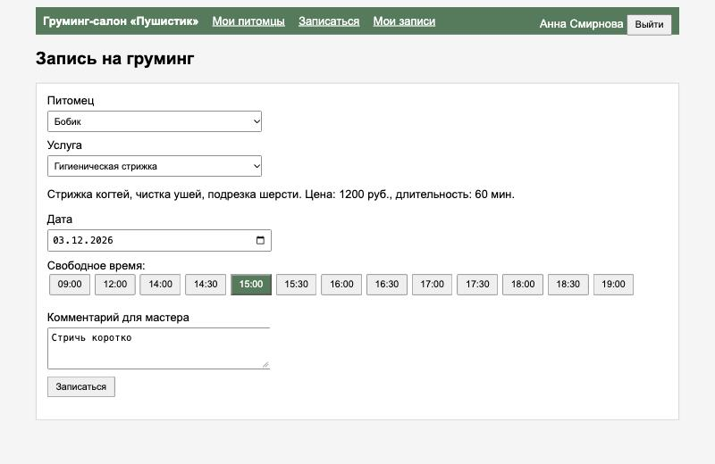
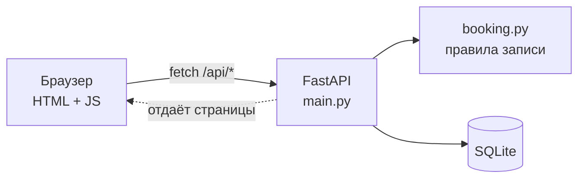

# 🐾 Груминг-салон «Пушистик»

**Онлайн-запись питомцев на груминг.** Клиент добавляет своих питомцев и сам выбирает свободное время, а администратор видит расписание всего салона.

| | |
|---|---|
| **Дисциплина** | Технологии создания программного обеспечения |
| **Автор** | Царегородцев Петр Васильевич |
| **Стек** | Python · FastAPI · SQLite · HTML/CSS/JS · Docker |
| **Запуск** | `docker compose up --build` → http://localhost:8000 |



---

## 📚 Документация

| Раздел | Что внутри |
|--------|------------|
| [1. Описание проекта](docs/1_opisanie.md) | назначение, проблема, пользователи, функции, требования, распределение обязанностей |
| [2. Проектирование](docs/2_proektirovanie.md) | Use Case, Activity, ER, Component, Sequence, прототипы, выбор технологий |
| [3. Backend](docs/3_backend.md) | таблицы БД, бизнес-логика записи, авторизация, REST API, ошибки |
| [4. Frontend](docs/4_frontend.md) | 6 экранов со скриншотами, работа с API, пустые состояния и ошибки |
| [5. Тестирование](docs/5_testirovanie.md) | план, 27 тест-кейсов, результаты, исправленные ошибки |

## ✅ Соответствие требованиям

| Требование | Как выполнено | Где |
|------------|---------------|-----|
| Не менее 5 функций | 6 функций (F1–F6) | [1.4](docs/1_opisanie.md#14-основные-функции) |
| Функциональные и нефункциональные требования | 8 FR + 8 НФТ | [1.5–1.6](docs/1_opisanie.md#15-функциональные-требования) |
| Use Case, Activity, ER, Component, Sequence | все 5 диаграмм на Mermaid | [2](docs/2_proektirovanie.md) |
| Прототипы экранов | 4 макета | [2.6](docs/2_proektirovanie.md#26-прототипы-экранов) |
| REST API + CRUD | 17 эндпоинтов, CRUD питомцев и услуг | [3.5](docs/3_backend.md#35-rest-api) |
| Не менее 3 связанных сущностей | 5 таблиц: users, sessions, pets, services, appointments | [3.2](docs/3_backend.md#32-база-данных) |
| Авторизация и права | токены, роли клиент / администратор | [3.4](docs/3_backend.md#34-авторизация-и-права) |
| Валидация и обработка ошибок | Pydantic, коды 401 / 403 / 404 / 409 / 422 | [3.6](docs/3_backend.md#36-обработка-ошибок) |
| Swagger / OpenAPI | http://localhost:8000/docs | [3.5](docs/3_backend.md#35-rest-api) |
| Не менее 4 экранов | 6 экранов | [4.1](docs/4_frontend.md#41-экраны) |
| Загрузка, пустые состояния, ошибки | на каждой странице | [4.3](docs/4_frontend.md#43-загрузка-пустые-состояния-и-ошибки) |
| Не менее 15 тест-кейсов | 27 тест-кейсов | [5.2](docs/5_testirovanie.md#52-тест-кейсы) |
| Автотесты бизнес-логики | 26 автотестов pytest | [5.3](docs/5_testirovanie.md#53-результаты) |
| Отчёт об исправленных ошибках | 4 ошибки | [5.4](docs/5_testirovanie.md#54-найденные-и-исправленные-ошибки) |
| Локальный запуск | Docker Compose или Python | [ниже](#-запуск) |

## 🏗 Архитектура



Один сервер FastAPI отдаёт и API, и страницы сайта. Подробнее — в [разделе 2](docs/2_proektirovanie.md#24-component-diagram).

## 📁 Структура проекта

```
grooming-salon/
├── backend/
│   ├── app/
│   │   ├── main.py          # эндпоинты API и проверка прав
│   │   ├── booking.py       # правила записи
│   │   ├── db.py            # таблицы и подключение к SQLite
│   │   └── security.py      # хеширование паролей
│   ├── tests/test_api.py    # 26 автотестов
│   └── requirements.txt
├── frontend/
│   ├── index.html           # вход и регистрация
│   ├── pets.html            # мои питомцы
│   ├── book.html            # запись
│   ├── my.html              # мои записи
│   ├── admin.html           # все записи (админ)
│   ├── services.html        # услуги (админ)
│   ├── common.js            # функция api() и меню
│   └── style.css
├── docs/                    # документация, диаграммы, скриншоты
├── Dockerfile
└── compose.yaml
```

## 🚀 Запуск

### Вариант 1 — Docker (рекомендуется)

Нужен запущенный Docker Desktop.

```bash
docker compose up --build
```

| Адрес | Что открывается |
|-------|-----------------|
| http://localhost:8000 | сайт |
| http://localhost:8000/docs | Swagger |

База хранится в томе `salon-data` и сохраняется после `docker compose down`. Удалить её вместе с контейнером: `docker compose down -v`.

### Вариант 2 — без Docker

Нужен Python 3.10 или новее.

```bash
python3 -m venv .venv
source .venv/bin/activate      # Windows: .venv\Scripts\activate
pip install -r backend/requirements-test.txt
cd backend
uvicorn app.main:app --reload
```

### Вход

| Роль | Логин | Пароль |
|------|-------|--------|
| Администратор | `admin@salon.ru` | `admin123` |
| Клиент | зарегистрироваться на главной | — |

## 🧪 Тесты

```bash
cd backend
python -m pytest -v
```

Результат: **26 passed**. Подробности — в [разделе 5](docs/5_testirovanie.md).
