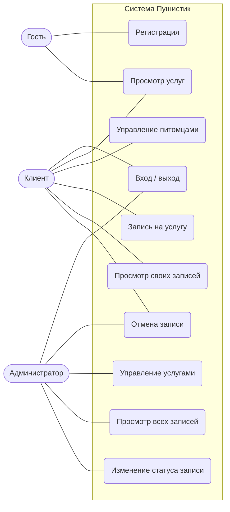
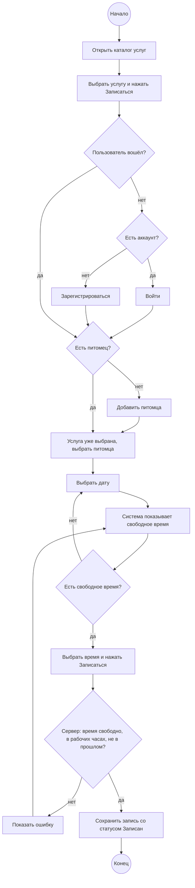
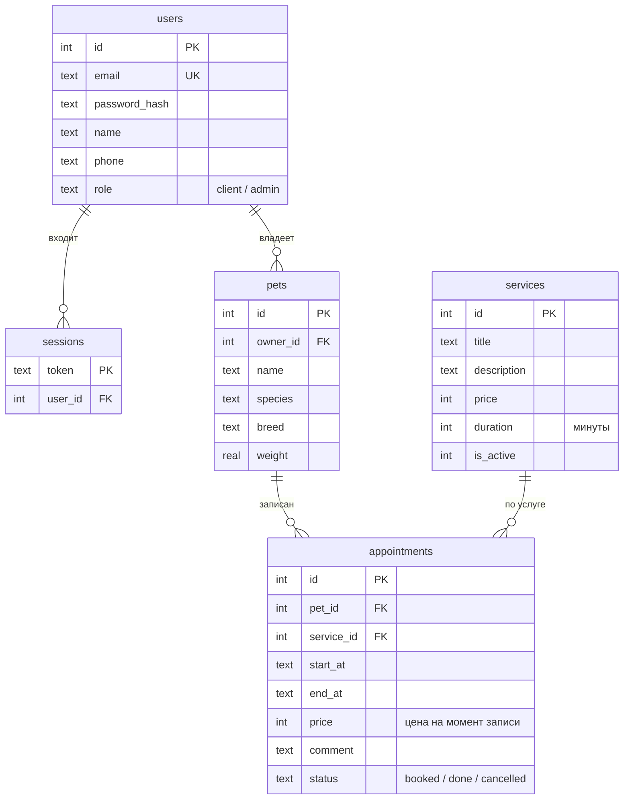
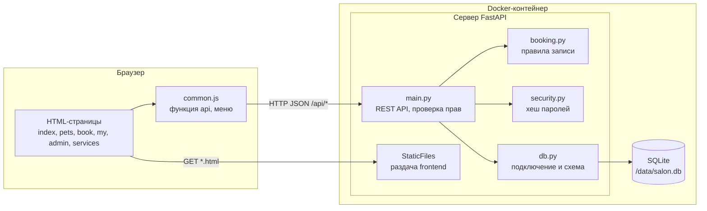
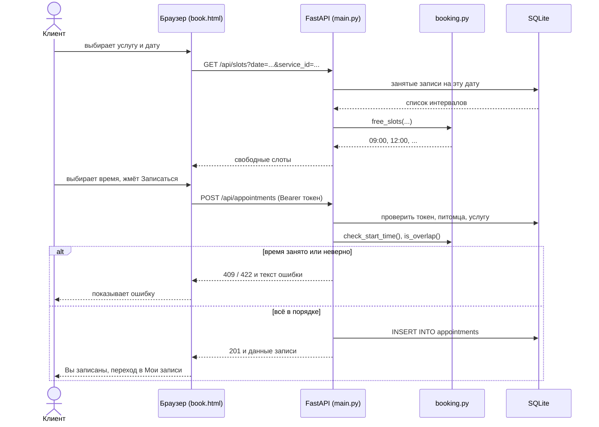
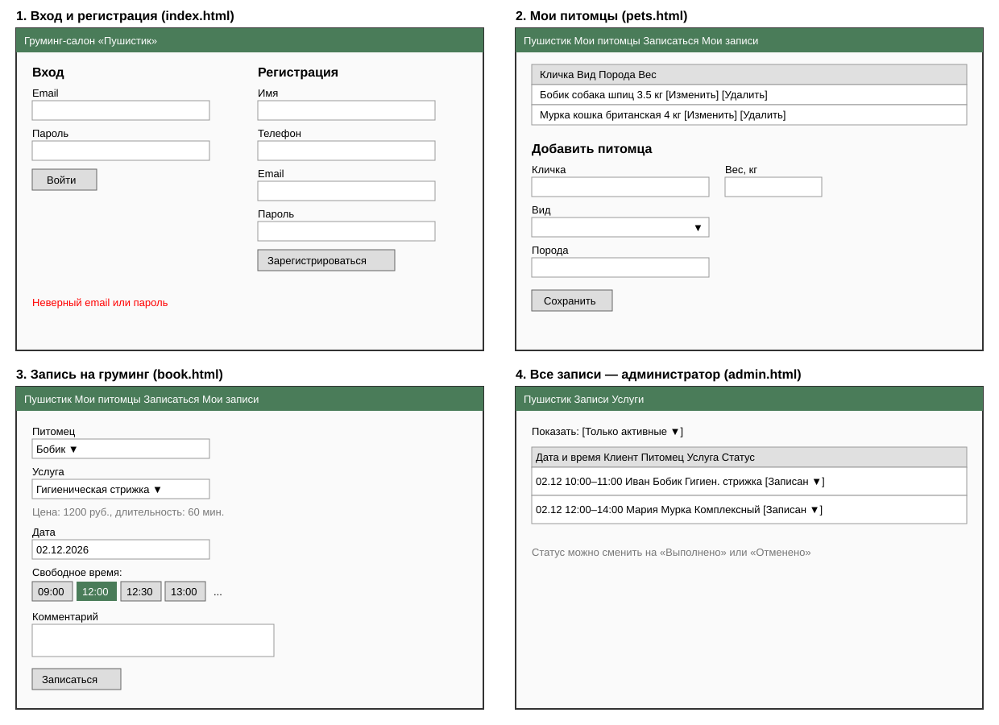

[README](../README.md) · [1. Описание](1_opisanie.md) · **2. Проектирование** · [3. Backend](3_backend.md) · [4. Frontend](4_frontend.md) · [5. Тестирование](5_testirovanie.md)

# 2. Аналитика и проектирование

> **Кратко:** пять обязательных диаграмм (Use Case, Activity, ER, Component, Sequence), прототипы экранов и выбор технологий.

| Диаграмма | Что показывает | Раздел |
|-----------|----------------|:------:|
| Use Case | кто и что делает в системе | [2.1](#21-use-case-diagram) |
| Activity | процесс записи на услугу | [2.2](#22-activity-diagram--запись-на-услугу) |
| ER | таблицы базы данных и связи | [2.3](#23-er-diagram) |
| Component | из каких частей состоит система | [2.4](#24-component-diagram) |
| Sequence | обмен запросами при записи | [2.5](#25-sequence-diagram--запись-на-услугу) |

## 2.1 Use Case Diagram

## 2.2 Activity Diagram — запись на услугу

## 2.3 ER Diagram

Подробное описание таблиц — в [3. Backend](3_backend.md#32-база-данных).

## 2.4 Component Diagram

## 2.5 Sequence Diagram — запись на услугу

## 2.6 Прототипы экранов

Черновые макеты, нарисованные до разработки:

Как экраны выглядят в готовом приложении — в [4. Frontend](4_frontend.md).

## 2.7 Технологии и почему выбраны они

| Слой | Технология | Почему именно она |
|------|------------|-------------------|
| Backend | Python + **FastAPI** | мало кода; сам проверяет входные данные по схемам и делает Swagger |
| Сервер | **Uvicorn** | стандартный сервер для FastAPI |
| База данных | **SQLite** | встроена в Python, не нужно ставить отдельную СУБД |
| Frontend | **HTML + CSS + JavaScript** | без сборки и фреймворков, каждую страницу легко понять |
| Тесты | **pytest** + TestClient | стандарт для Python, тесты API без запуска сервера |
| Запуск | **Docker Compose** | одинаковый запуск на любом компьютере одной командой |
| Диаграммы | **Mermaid** | пишутся текстом и сразу отображаются на GitHub |

---

← [1. Описание](1_opisanie.md) · Далее: [3. Backend →](3_backend.md)
