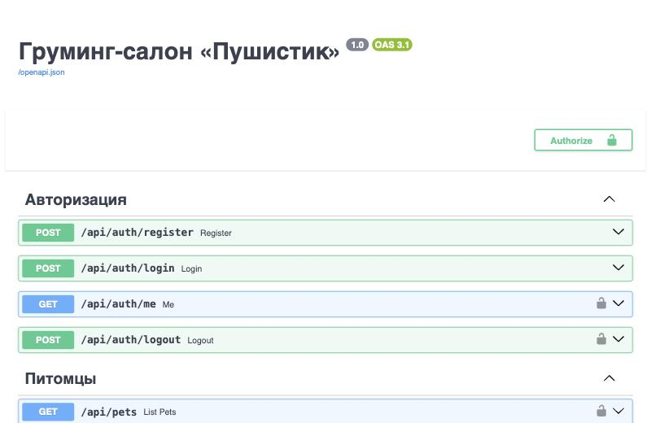

[README](../README.md) · [1. Описание](1_opisanie.md) · [2. Проектирование](2_proektirovanie.md) · **3. Backend** · [4. Frontend](4_frontend.md) · [5. Тестирование](5_testirovanie.md)

# 3. Backend

> **Кратко:** сервер на FastAPI, база SQLite из 5 таблиц, 17 эндпоинтов REST API, вход по токену, две роли и правила записи в отдельном модуле.

## 3.1 Устройство сервера

| Файл | За что отвечает |
|------|-----------------|
| `backend/app/main.py` | все эндпоинты API, схемы входных данных, проверка прав |
| `backend/app/booking.py` | бизнес-логика записи: рабочие часы, пересечения, свободные слоты, отмена |
| `backend/app/db.py` | подключение к SQLite, создание таблиц, стартовые данные |
| `backend/app/security.py` | хеширование и проверка паролей |

Сервер отдаёт и API (`/api/...`), и страницы сайта (папка `frontend`), поэтому всё работает на одном адресе `http://localhost:8000`.

## 3.2 База данных

СУБД — SQLite. Таблицы создаются сами при первом запуске. Тогда же добавляются администратор и 4 услуги.

**users** — пользователи

| Поле | Тип | Описание |
|------|-----|----------|
| id | INTEGER PK | номер пользователя |
| email | TEXT UNIQUE | логин, хранится в нижнем регистре |
| password_hash | TEXT | соль и хеш пароля |
| name | TEXT | имя |
| phone | TEXT | телефон |
| role | TEXT | `client` или `admin` |

**sessions** — токены входа

| Поле | Тип | Описание |
|------|-----|----------|
| token | TEXT PK | случайная строка из 64 символов |
| user_id | INTEGER FK → users | чей токен; удаляется вместе с пользователем |

**pets** — питомцы

| Поле | Тип | Описание |
|------|-----|----------|
| id | INTEGER PK | номер питомца |
| owner_id | INTEGER FK → users | владелец |
| name | TEXT | кличка |
| species | TEXT | `собака`, `кошка` или `другое` |
| breed | TEXT | порода |
| weight | REAL | вес в кг, больше 0 |

**services** — услуги

| Поле | Тип | Описание |
|------|-----|----------|
| id | INTEGER PK | номер услуги |
| title | TEXT | название |
| description | TEXT | описание |
| price | INTEGER | цена в рублях, больше 0 |
| duration | INTEGER | длительность в минутах, кратна 30 |
| is_active | INTEGER | 1 — доступна для записи, 0 — отключена |

**appointments** — записи

| Поле | Тип | Описание |
|------|-----|----------|
| id | INTEGER PK | номер записи |
| pet_id | INTEGER FK → pets | какой питомец |
| service_id | INTEGER FK → services | какая услуга |
| start_at / end_at | TEXT | начало и конец, формат `2026-12-03T10:00` |
| price | INTEGER | цена на момент записи |
| comment | TEXT | пожелание мастеру |
| status | TEXT | `booked`, `done` или `cancelled` |

**Целостность данных:** уникальный email; `CHECK` на роль, статус, вес и цену; внешние ключи включены (`PRAGMA foreign_keys = ON`).

## 3.3 Бизнес-логика записи

Все правила лежат в `booking.py`. Это обычные функции без FastAPI, поэтому их легко тестировать.

| № | Правило | Значение |
|:-:|---------|----------|
| 1 | Рабочее время | с 9:00 до 20:00, запись должна закончиться до закрытия |
| 2 | Сетка | начало только в :00 или :30 |
| 3 | Конец записи | начало + длительность услуги |
| 4 | Пересечения | мастер один, активные записи не пересекаются |
| 5 | Прошлое | записаться на прошедшее время нельзя |
| 6 | Цена | копируется в запись и потом не меняется |
| 7 | Отмена клиентом | не позже чем за 2 часа до начала |
| 8 | Отмена администратором | в любое время |
| 9 | Отключённая услуга | не видна при записи, старые записи остаются |

Две записи пересекаются, если `начало1 < конец2` и `начало2 < конец1`.
Поэтому записи 10:00–11:00 и 11:00–12:00 **не** пересекаются.

**Пример расчёта.** Сейчас 01.12, 10:00. На 02.12 уже есть запись «Комплексный груминг» (120 мин) на 10:00.

| Действие | Интервал | Результат |
|----------|----------|-----------|
| запись «Гигиеническая стрижка» (60 мин) на 11:00 | 11:00–12:00 | ❌ 409 — пересекается с 10:00–12:00 |
| та же услуга на 12:00 | 12:00–13:00 | ✅ 201 — начинается ровно в конце другой |
| та же услуга на 19:30 | 19:30–20:30 | ❌ 422 — заканчивается после закрытия |
| та же услуга на 10:15 | — | ❌ 422 — не по сетке 30 минут |
| свободные слоты на 02.12 для 60 мин (до записи на 12:00) | — | 09:00, 12:00, 12:30, …, 19:00 |

## 3.4 Авторизация и права

1. При регистрации или входе сервер создаёт случайный токен и сохраняет его в `sessions`.
2. Браузер хранит токен в `localStorage` и отправляет его в каждом запросе: `Authorization: Bearer <токен>`.
3. При выходе токен удаляется из базы.

| Проверка | Где в коде | Ответ при нарушении |
|----------|-----------|---------------------|
| есть ли токен и действует ли он | `current_user()` | 401 |
| является ли пользователь администратором | `admin_user()` | 403 |
| принадлежит ли питомец пользователю | `get_own_pet()` | 404 |
| принадлежит ли запись пользователю | `get_appointment_for()` | 404 |

Пароль хранится как `соль:хеш`, где хеш — PBKDF2-SHA256 со 100 000 итераций.

## 3.5 REST API

Полная интерактивная документация — **Swagger**: http://localhost:8000/docs



| Группа | Метод | Адрес | Доступ | Что делает |
|--------|:-----:|-------|--------|------------|
| Авторизация | POST | `/api/auth/register` | все | регистрация, возвращает токен |
| | POST | `/api/auth/login` | все | вход, возвращает токен |
| | GET | `/api/auth/me` | вошедший | текущий пользователь |
| | POST | `/api/auth/logout` | вошедший | выход |
| Питомцы | GET | `/api/pets` | клиент | мои питомцы |
| | POST | `/api/pets` | клиент | добавить |
| | PUT | `/api/pets/{id}` | владелец | изменить |
| | DELETE | `/api/pets/{id}` | владелец | удалить |
| Услуги | GET | `/api/services` | все | список |
| | POST | `/api/services` | админ | добавить |
| | PUT | `/api/services/{id}` | админ | изменить |
| | DELETE | `/api/services/{id}` | админ | удалить |
| Записи | GET | `/api/slots?date=&service_id=` | все | свободное время |
| | GET | `/api/appointments` | вошедший | клиент — свои, админ — все |
| | POST | `/api/appointments` | клиент | записаться |
| | POST | `/api/appointments/{id}/cancel` | владелец, админ | отменить |
| | PATCH | `/api/appointments/{id}/status` | админ | сменить статус |

**Пример запроса:**

```http
POST /api/appointments
Authorization: Bearer 3f9a...
Content-Type: application/json

{"pet_id": 1, "service_id": 2, "start_at": "2026-12-03T10:00", "comment": "боится фена"}
```

**Ответ `201 Created`:**

```json
{
  "id": 1, "pet_id": 1, "service_id": 2,
  "start_at": "2026-12-03T10:00", "end_at": "2026-12-03T12:00",
  "price": 3000, "status": "booked", "comment": "боится фена",
  "pet_name": "Бобик", "service_title": "Комплексный груминг"
}
```

## 3.6 Обработка ошибок

| Код | Когда возвращается | Пример текста |
|:---:|--------------------|---------------|
| 401 | нет токена или он устарел | «Нужно войти в систему» |
| 403 | клиент вызывает метод администратора | «Доступно только администратору» |
| 404 | объекта нет или он чужой | «Питомец не найден» |
| 409 | конфликт с данными | «Это время уже занято, выберите другое» |
| 422 | неверные входные данные | «Салон работает с 9:00 до 20:00» |

---

← [2. Проектирование](2_proektirovanie.md) · Далее: [4. Frontend →](4_frontend.md)
