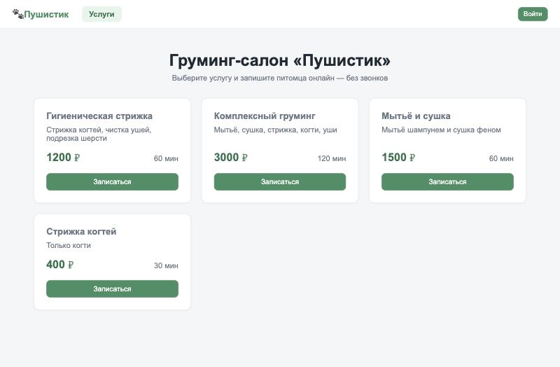
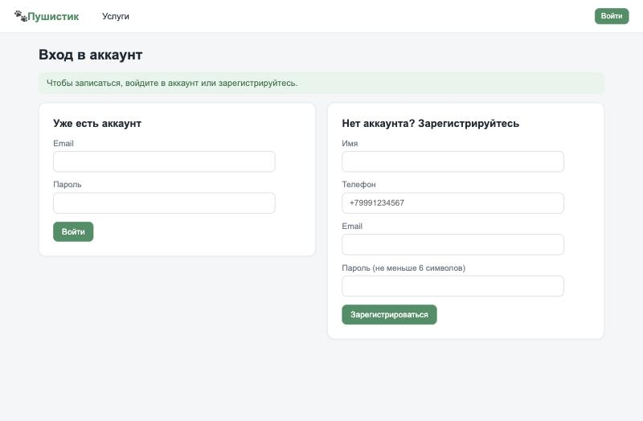
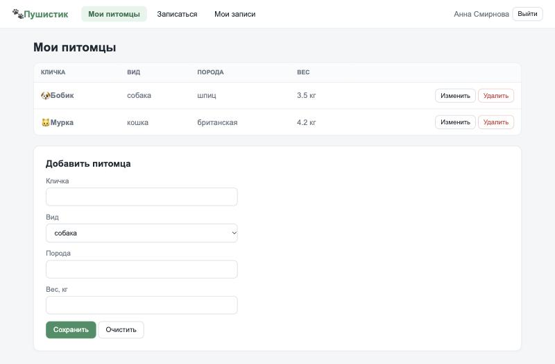
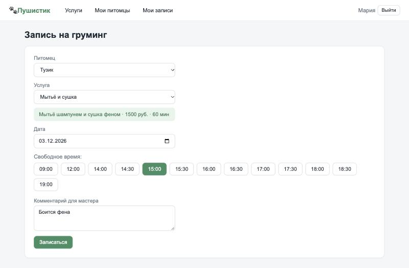
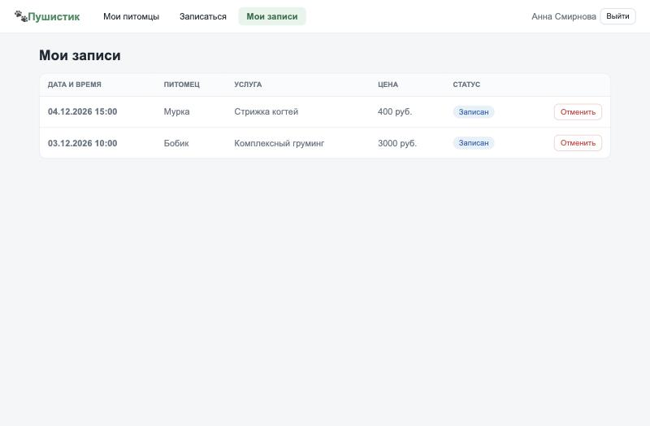
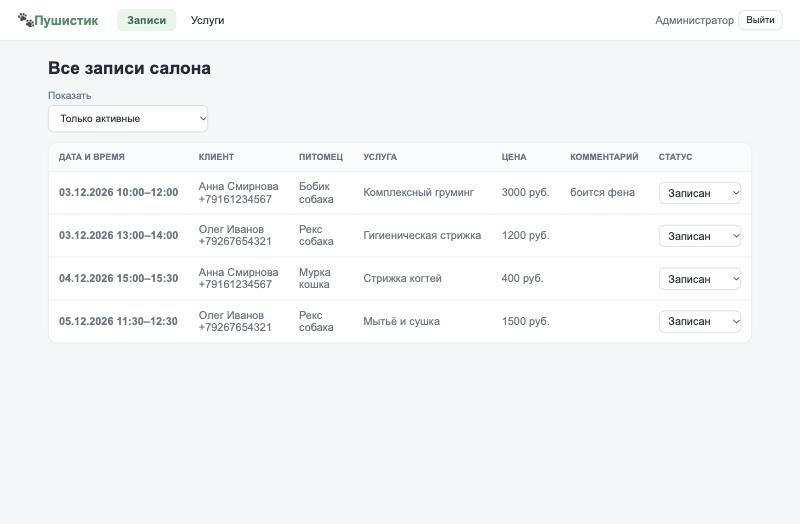
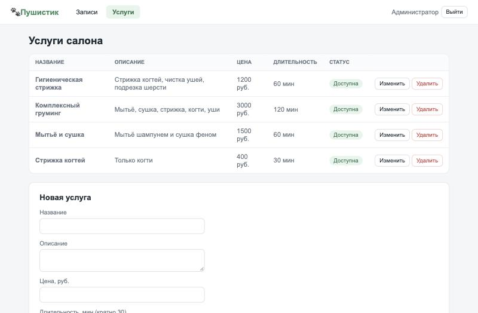
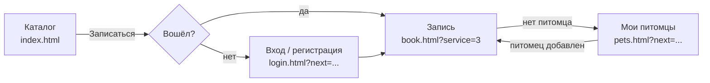

[README](../README.md) · [1. Описание](1_opisanie.md) · [2. Проектирование](2_proektirovanie.md) · [3. Backend](3_backend.md) · **4. Frontend** · [5. Тестирование](5_testirovanie.md)

# 4. Frontend

> **Кратко:** 7 экранов на HTML и JavaScript без фреймворков. Все запросы к серверу идут через одну функцию `api()` в `common.js`.

## 4.1 Экраны

| № | Экран | Файл | Кто видит |
|:-:|-------|------|-----------|
| 0 | Каталог услуг (главная) | `index.html` | все |
| 1 | Вход и регистрация | `login.html` | гость |
| 2 | Мои питомцы | `pets.html` | клиент |
| 3 | Запись на груминг | `book.html` | клиент |
| 4 | Мои записи | `my.html` | клиент |
| 5 | Все записи салона | `admin.html` | администратор |
| 6 | Услуги салона | `services.html` | администратор |

### 0. Каталог услуг

Главная страница открывается без входа. Здесь карточки всех доступных услуг с ценой и длительностью.



### 1. Вход и регистрация

Сюда гость попадает, когда нажимает «Записаться». Слева форма входа, справа регистрация. После входа или регистрации пользователь сразу возвращается к записи на выбранную услугу. Администратор попадает на «Все записи».



### 2. Мои питомцы

Таблица питомцев и форма. Кнопка «Изменить» подставляет данные питомца в форму, «Удалить» сначала спрашивает подтверждение.



### 3. Запись на груминг

Услуга, выбранная в каталоге, уже подставлена. Остаётся выбрать питомца и дату. Свободное время загружается с сервера при каждой смене услуги или даты. Выбранное время подсвечивается.



### 4. Мои записи

Список записей клиента со статусами. Кнопка «Отменить» есть только у активных записей.



### 5. Все записи (администратор)

Все записи салона с контактами клиентов и фильтром «Только активные / Все». Статус меняется прямо в таблице.



### 6. Услуги (администратор)

Таблица и форма услуги. Услугу можно отключить галочкой «Доступна для записи».



## 4.2 Сценарий записи для нового пользователя



Куда вернуть пользователя, передаётся в адресе параметром `next`. Функция `getNext()` пропускает только адреса наших страниц вида `book.html?service=3`. Поэтому через ссылку нельзя увести пользователя на чужой сайт.

## 4.3 Работа с API

Все запросы идут через функцию `api(method, url, body)` из `common.js`:

```js
const pets = await api('GET', '/pets');
await api('POST', '/appointments', { pet_id: 1, service_id: 2, start_at: '2026-12-03T10:00' });
```

Что делает функция:
- добавляет заголовок `Authorization: Bearer <токен>`;
- при ответе 401 стирает токен и отправляет на страницу входа;
- при ошибке выбрасывает исключение с текстом от сервера, а страница показывает его пользователю.

## 4.4 Загрузка, пустые состояния и ошибки

| Ситуация | Что видит пользователь | Где |
|----------|------------------------|-----|
| идёт запрос | «Загрузка...» | все списки, свободное время |
| нет питомцев | «У вас пока нет питомцев. Добавьте первого ниже.» | pets.html |
| нет питомцев при записи | «Чтобы записаться, сначала добавьте питомца» со ссылкой | book.html |
| нет записей | «Записей пока нет. Выбрать услугу» | my.html |
| нет свободного времени | «На этот день свободного времени нет» | book.html |
| время не выбрано | «Выберите время» | book.html |
| ошибка сервера | текст ошибки красным | все формы |
| сервер недоступен | «Нет связи с сервером» | все страницы |
| удаление или отмена | окно подтверждения | pets, services, my |

## 4.5 Защита от XSS

Всё, что ввёл пользователь (клички, комментарии, имена), выводится через функцию `esc()`. Она заменяет `< > & " '` на HTML-сущности, поэтому вставить свой код на страницу нельзя.

---

← [3. Backend](3_backend.md) · Далее: [5. Тестирование →](5_testirovanie.md)
