# Отчёт по проекту «Пушистик — онлайн-запись в груминг-салон»

**Дисциплина** — Технологии создания программного обеспечения.

**Год** — 2026.

**Автор** — Царегородцев Петр Васильевич.

**Результат** — веб-приложение для записи питомцев на груминг и ведения расписания салона.

## Содержание

1. [Введение](#1-введение)
2. [Анализ предметной области](#2-анализ-предметной-области)
3. [Техническое задание](#3-техническое-задание)
4. [Бизнес-логика](#4-бизнес-логика)
5. [Проектирование](#5-проектирование)
6. [Проектирование API](#6-проектирование-api)
7. [План тестирования и результаты](#7-план-тестирования-и-результаты)
8. [Заключение](#8-заключение)

## 1. Введение

В небольших груминг-салонах запись обычно идёт по телефону, а расписание ведётся в тетради. Клиент не знает, какое время свободно, и звонит несколько раз. Администратор тратит рабочее время на звонки, а иногда записывает двух клиентов на одно и то же время. Сведения о питомцах (порода, вес) приходится уточнять заново при каждом визите.

Цель проекта — сайт, на котором клиент сам выбирает услугу, видит только свободное время и записывает питомца, а администратор видит расписание всего салона в одной таблице. Целевая аудитория — владельцы собак и кошек и сотрудники небольших салонов. Пользователи делятся на гостей, клиентов и администратора. Состав функций описан в [исходном описании](../README.md#1-функциональные-возможности).

## 2. Анализ предметной области

| Понятие | Значение в приложении |
|---|---|
| Клиент | Владелец питомца с аккаунтом. Видит только своих питомцев и свои записи. |
| Администратор | Сотрудник салона. Ведёт каталог услуг и управляет всеми записями. |
| Питомец | Карточка животного клиента: кличка, вид (собака, кошка, другое), порода, вес. |
| Услуга | Позиция каталога с названием, описанием, ценой в рублях и длительностью, кратной 30 минутам. |
| Запись | Питомец, услуга, время начала и конца, цена на момент записи, комментарий и статус. |
| Слот | Время начала записи по сетке 30 минут, при котором услуга целиком помещается в рабочий день и ни с чем не пересекается. |
| Статус записи | «Записан» (активна), «Выполнено» или «Отменено». Время занимают только активные записи. |

Все записи относятся к питомцу, а питомец — к клиенту. Поэтому права доступа проверяются по цепочке «запись → питомец → владелец».

## 3. Техническое задание

Гость может посмотреть каталог, зарегистрироваться по email, паролю, имени и телефону или войти. Время записи задаётся в часовом поясе салона (Москва), цены — в целых рублях. Салон работает с 9:00 до 20:00, мастер один.

| Код | Входные данные и действие | Наблюдаемый результат и критерий приёмки |
|---|---|---|
| F1 | Регистрация, вход и выход по email и паролю | После регистрации пользователь сразу входит. Повторный email (в любом регистре) даёт ошибку 409. После выхода старый токен не принимается. |
| F2 | Гость открывает главную страницу | Видны все доступные услуги с ценой и длительностью. По кнопке «Записаться» гостя переносит на вход, а после входа или регистрации возвращает к записи на эту услугу. |
| F3 | Клиент добавляет, изменяет или удаляет питомца | Изменения видны в списке. Чужого питомца изменить нельзя (404). Питомца с активной записью удалить нельзя (409). |
| F4 | Клиент выбирает услугу, питомца, дату и время | Показываются только свободные слоты. Запись в прошлое, вне рабочих часов, не по сетке или на занятое время отклоняется с понятным сообщением. |
| F5 | Клиент открывает свои записи и отменяет одну из них | Видны только записи своих питомцев. Отмена разрешена не позже чем за 2 часа до начала, после отмены время снова свободно. |
| F6 | Администратор ведёт услуги и записи | Клиент на эти действия получает 403. Услугу с записями нельзя удалить, только отключить. Администратор меняет статус и отменяет записи в любое время. |

Сервер проверяет все входные данные и права доступа к питомцам и записям. Пароль хранится как соль и хеш PBKDF2-SHA256 со 100 000 итераций. Сессия — случайный токен из 64 символов в заголовке `Authorization: Bearer`, он удаляется при выходе. Описание API доступно в Swagger, а приложение запускается одной командой Docker Compose.

## 4. Бизнес-логика

### Рабочее время и свободные слоты

Запись начинается не раньше 9:00 и заканчивается не позже 20:00. Время конца считается как `начало + длительность услуги`, поэтому услуга на 60 минут в 19:30 отклоняется: она закончилась бы после закрытия. Начало допускается только в :00 или :30. Записаться на уже прошедшее время нельзя. Свободные слоты перебираются от 9:00 с шагом 30 минут. Слот пропускается, если он в прошлом, выходит за 20:00 или пересекается с активной записью.

### Пересечение записей

Две записи пересекаются, если `начало1 < конец2` и `начало2 < конец1`. Запись, которая начинается ровно в момент окончания другой, разрешена. Отменённые и выполненные записи время не занимают.

**Контрольный пример.** Сейчас 1 декабря, 10:00. На 2 декабря уже есть запись «Комплексный груминг» (120 минут) на 10:00.

| Шаг | Интервал | Результат |
|---|---|---|
| Записаться на «Гигиеническую стрижку» (60 мин) на 11:00 | 11:00–12:00 | отказ 409, время занято |
| Та же услуга на 12:00 | 12:00–13:00 | запись создана, 201 |
| Та же услуга на 19:30 | 19:30–20:30 | отказ 422, после закрытия |
| Та же услуга на 10:15 | — | отказ 422, не по сетке |
| Отменить запись на 10:00 и снова записаться на 11:00 | 11:00–12:00 | запись создана, 201 |

### Цена, отмена и статусы

Цена услуги копируется в запись в момент записи. Если администратор позже меняет цену, старые записи не меняются. Клиент отменяет свою запись не позже чем за 2 часа до начала, администратор — в любое время. Когда администратор возвращает отменённую запись в статус «Записан», сервер снова проверяет, что время ещё свободно. Отключённая услуга не видна в каталоге и при записи, но её старые записи сохраняются.

## 5. Проектирование

### Архитектура и данные

Интерфейс — семь HTML-страниц с CSS и JavaScript без фреймворков. Все запросы к серверу идут через одну функцию `api()` в `common.js`. Сервер на FastAPI под Uvicorn отдаёт и страницы, и REST API на одном адресе. Pydantic проверяет входные данные, правила записи вынесены в отдельный модуль `booking.py` без зависимости от FastAPI. Данные хранятся в SQLite через стандартный модуль `sqlite3`. В Docker файл базы лежит в томе `salon-data`, а часовой пояс контейнера задан как `Europe/Moscow`.


*Рисунок 1. Компоненты браузера и сервера, обмен запросами HTTP/JSON и работа с базой данных.*


*Рисунок 2. Таблицы базы данных и связи между ними.*

| Таблица | Основные поля и связи |
|---|---|
| users | уникальный email в нижнем регистре, хеш пароля, имя, телефон, роль `client` или `admin` |
| sessions | токен сессии, ссылка на пользователя, удаляется вместе с ним |
| pets | владелец (ссылка на `users`), кличка, вид, порода, вес больше нуля |
| services | название, описание, цена больше нуля, длительность в минутах, признак доступности |
| appointments | питомец (ссылка на `pets`), услуга (ссылка на `services`), начало, конец, цена на момент записи, комментарий, статус |

### Целостность и сохранение

В базе действуют `CHECK`-ограничения: роль только `client` или `admin`, статус только `booked`, `done` или `cancelled`, вес и цена больше нуля. Внешние ключи включены командой `PRAGMA foreign_keys = ON`. При удалении пользователя каскадно удаляются его сессии и питомцы. Удалить услугу, на которую есть записи, сервер не даёт (409), её можно только отключить. Таблицы и стартовые данные (администратор и четыре услуги) создаются при первом запуске сервера. У каждого запроса своё соединение с базой.

### Интерфейс и сценарии

Варианты использования и бизнес-процесс записи показаны в [Use Case](../README.md#2-диаграмма-вариантов-использования-use-case) и на [диаграмме бизнес-процесса](../README.md#3-диаграмма-бизнес-процесса-bpmn). Ниже — макет, нарисованный до разработки, и экраны готового приложения. На каждой странице есть сообщение «Загрузка...» во время запроса, подсказка для пустого списка и текст ошибки от сервера.

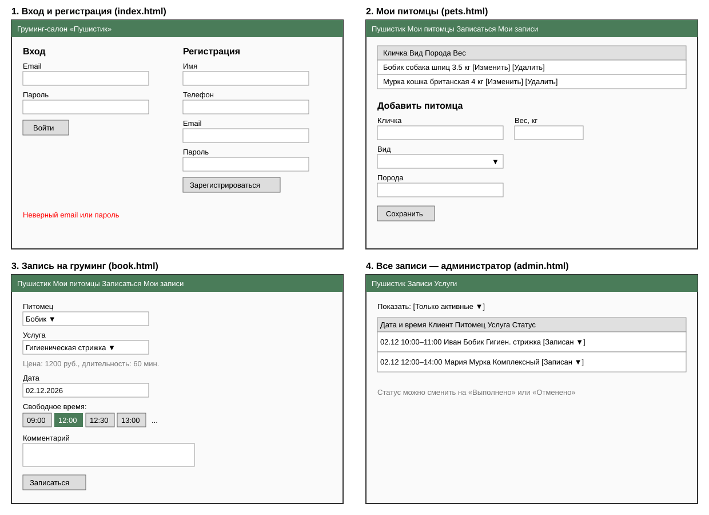

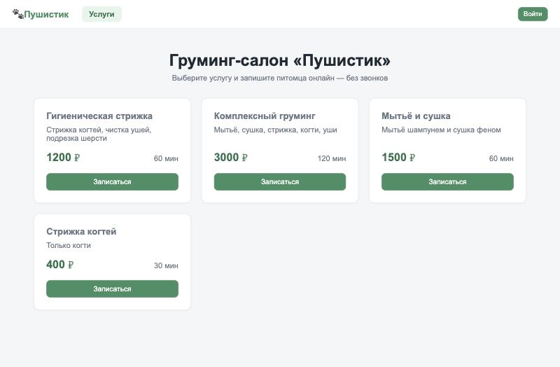

*Рисунок 3. Каталог услуг — главная страница, доступна без входа.*

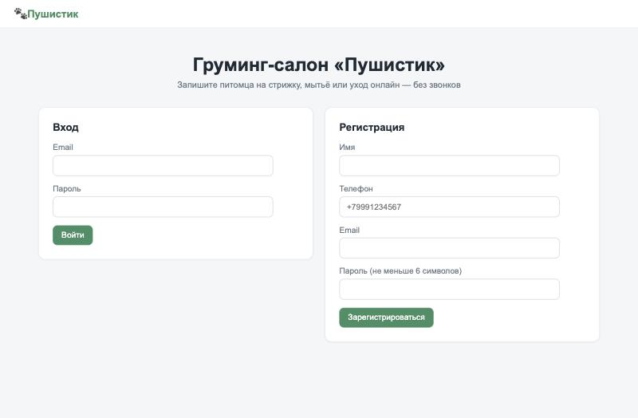

*Рисунок 4. Вход и регистрация — сюда переносит гостя после нажатия «Записаться».*

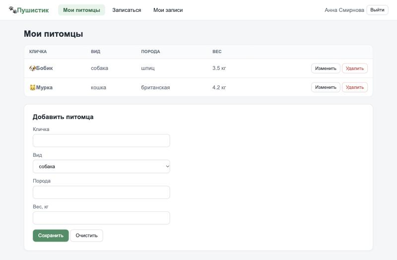

*Рисунок 5. Мои питомцы — список и форма добавления.*

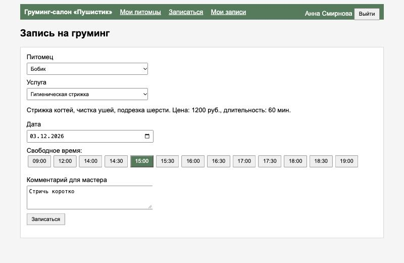

*Рисунок 6. Запись — выбранная услуга подставлена, свободное время загружается с сервера.*

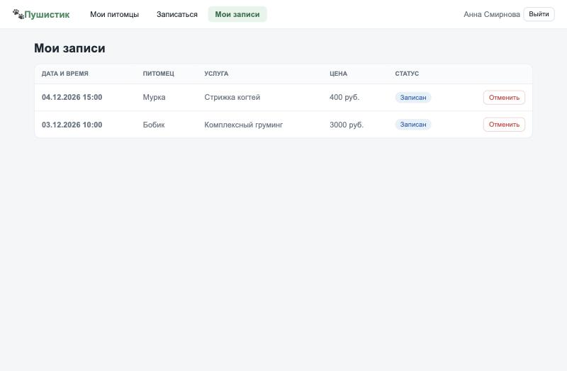

*Рисунок 7. Мои записи — статусы и отмена.*

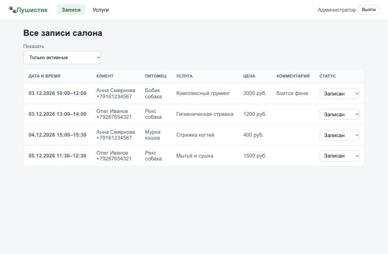

*Рисунок 8. Все записи салона — экран администратора со сменой статуса.*

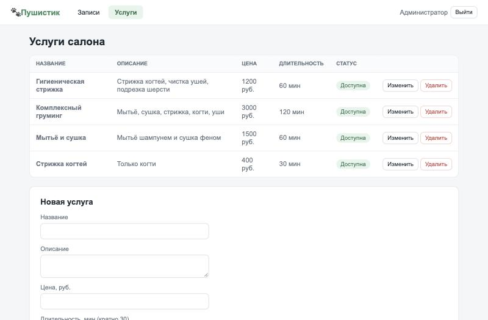

*Рисунок 9. Услуги салона — каталог для администратора.*

## 6. Проектирование API

Все пути начинаются с `/api`. Методы для питомцев и записей требуют токен, методы изменения услуг и статусов доступны только администратору. Полная документация доступна в Swagger по адресу `/docs`.

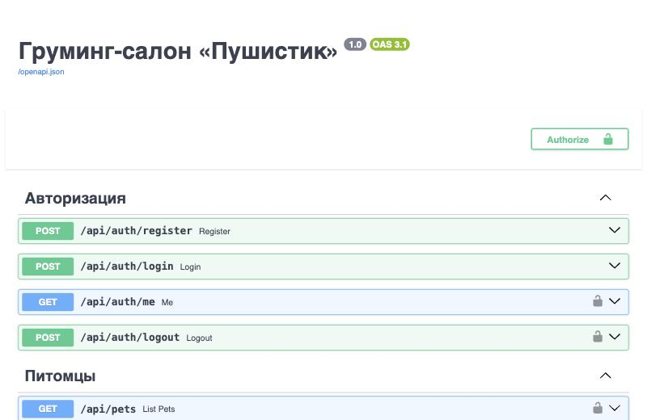

*Рисунок 10. Документация API в Swagger, методы разбиты на группы.*

| Метод | Путь | Результат |
|---|---|---|
| POST | /auth/register, /auth/login | создаёт аккаунт или проверяет пароль, возвращает токен и пользователя |
| GET | /auth/me | возвращает текущего пользователя |
| POST | /auth/logout | удаляет токен |
| GET, POST | /pets | список своих питомцев или новый питомец |
| PUT, DELETE | /pets/{id} | изменяет или удаляет своего питомца |
| GET, POST | /services | каталог услуг для всех или новая услуга (администратор) |
| PUT, DELETE | /services/{id} | изменяет или удаляет услугу (администратор) |
| GET | /slots?date=&service_id= | свободное время на дату для услуги |
| GET, POST | /appointments | свои записи (администратор видит все) или новая запись |
| POST | /appointments/{id}/cancel | отменяет запись |
| PATCH | /appointments/{id}/status | меняет статус записи (администратор) |

Пример: `POST /api/appointments` с телом `{"pet_id":1,"service_id":2,"start_at":"2026-12-03T10:00","comment":"боится фена"}` возвращает 201 и запись с концом `2026-12-03T12:00` и ценой 3000. Без токена сервер отвечает 401, на метод администратора от клиента — 403, на чужого питомца или запись — 404, на занятое время или повторный email — 409, на неверные данные — 422 с текстом ошибки на русском.

## 7. План тестирования и результаты

Автотесты API и бизнес-логики написаны на pytest с TestClient и лежат в [тестовом модуле](../backend/tests/test_api.py). Каждый тест получает свою временную базу SQLite, а время «сейчас» зафиксировано на 1 декабря 2026, 10:00. Интерфейс и запуск в Docker проверялись вручную в браузере по [инструкции запуска](../README.md#8-запуск).

| Проверка | Ожидаемый результат | Результат |
|---|---|---|
| TC-01. Регистрация | пользователь создан и сразу вошёл | Пройдено |
| TC-02. Повторный email в другом регистре | 409 | Пройдено |
| TC-03. Неверные данные регистрации | 422 | Пройдено |
| TC-04. Неверный пароль | 401 | Пройдено |
| TC-05. Выход и запрос со старым токеном | 401 | Пройдено |
| TC-06. Запрос без токена | 401 | Пройдено |
| TC-07. Добавление, изменение и удаление питомца | изменения видны в списке | Пройдено |
| TC-08. Отрицательный вес питомца | 422 | Пройдено |
| TC-09. Действия с чужим питомцем | 404 | Пройдено |
| TC-10. Удаление питомца с активной записью | 409 | Пройдено |
| TC-11. Клиент изменяет услугу | 403 | Пройдено |
| TC-12. Добавление, изменение и удаление услуги | все действия выполняются | Пройдено |
| TC-13. Длительность услуги 45 минут | 422 | Пройдено |
| TC-14. Удаление услуги с записями | 409 | Пройдено |
| TC-15. Запись на свободное время | запись 10:00–11:00, цена 1200 | Пройдено |
| TC-16. Изменение цены после записи | в записи старая цена | Пройдено |
| TC-17. Запись на занятое время и сразу после него | 409, затем 201 | Пройдено |
| TC-18. Запись в прошлое и на 21:00 | 422 | Пройдено |
| TC-19. Запись на отключённую услугу | 404 | Пройдено |
| TC-20. Свободные слоты после записи | 10:00 занято, 11:00 свободно | Пройдено |
| TC-21. Границы правил: пересечение впритык, рабочие часы, сетка | правила `booking.py` срабатывают верно | Пройдены 9 случаев |
| TC-22. Отмена освобождает время | повторная запись на то же время создана | Пройдено |
| TC-23. Отмена за час до начала клиентом и администратором | клиент 409, администратор 200 | Пройдено |
| TC-24. Записи двух клиентов | клиент видит 1, администратор 2, статус меняет только администратор | Пройдено |
| TC-25. Пустые состояния интерфейса | подсказки «нет питомцев», «записей пока нет» | Пройдено |
| TC-26. Сервер недоступен | сообщение «Нет связи с сервером» | Пройдено |
| TC-27. Запуск через Docker Compose | сайт и Swagger открываются, данные сохраняются после перезапуска | Пройдено |
| TC-28. Запись гостем из каталога | переход на вход, после регистрации — запись на выбранную услугу | Пройдено |
| TC-29. Нет питомца при записи | после добавления питомца возврат к записи с той же услугой | Пройдено |

Итог: 26 автотестов из 26 пройдены, все 29 проверок дали ожидаемый результат.

**Найденные и исправленные ошибки.** При ручной проверке в Docker страница питомцев показала «Ошибка 500». FastAPI открывал соединение с SQLite в одном потоке, а запрос выполнял в другом. Исправлено параметром `check_same_thread=False`, после этого 40 запросов подряд вернули 200. При первом запуске pytest не находил тесты, потому что Python не видел пакет `app`. Исправлено файлом `pytest.ini` с `pythonpath = .`. В Docker время шло по UTC, на 3 часа меньше московского, и на сегодня предлагались уже прошедшие слоты. Исправлено переменной `TZ=Europe/Moscow` в `compose.yaml`. В таблице администратора выпадающий список статуса занимал полтаблицы из-за общей ширины полей 300px. Исправлено отдельным стилем для списков внутри таблицы. В Swagger все методы были в одной группе «default». Методы разбиты на группы «Авторизация», «Питомцы», «Услуги», «Записи».

## 8. Заключение

Все шесть функций реализованы: аккаунты, каталог услуг, питомцы, запись с подбором свободного времени, просмотр и отмена записей, администрирование. Сервер проверяет данные и права доступа, документация API доступна в Swagger, приложение запускается одной командой Docker Compose. Описание функций, диаграммы вариантов использования, бизнес-процесса, базы данных, архитектуры и последовательности собраны в [README](../README.md).
