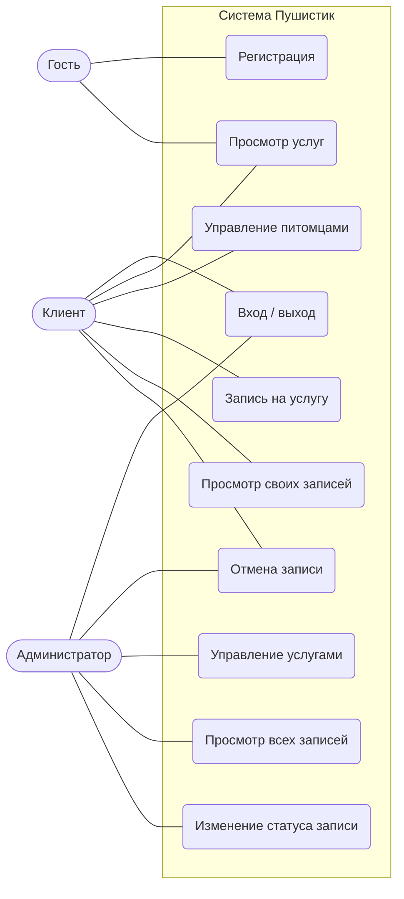
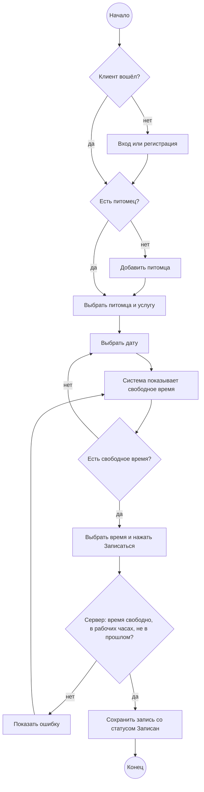
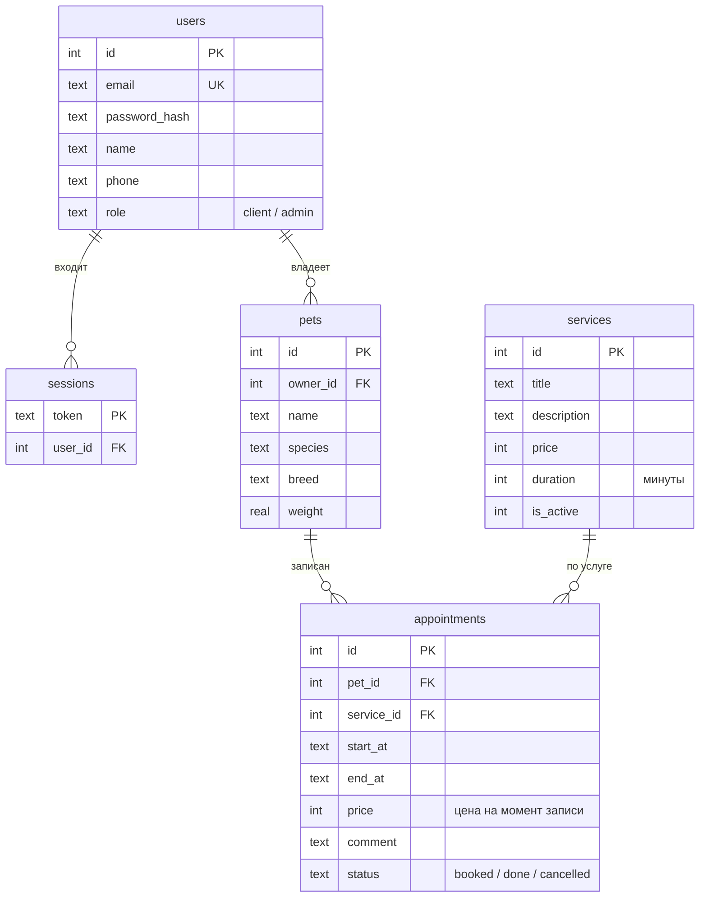
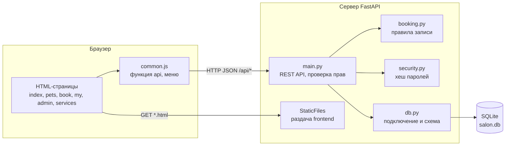
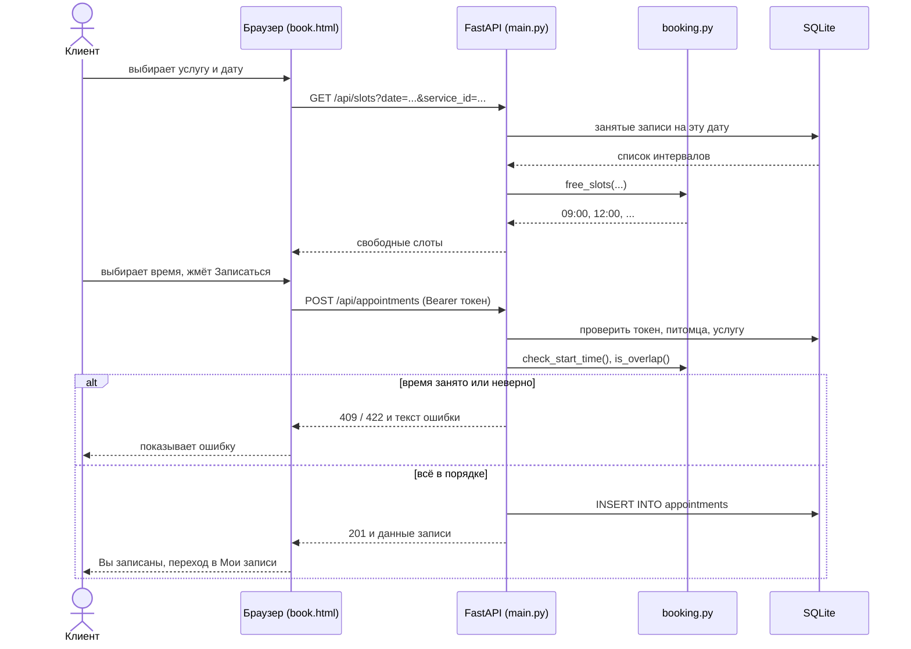

# Отчёт по проекту «Груминг-салон „Пушистик“»

Дисциплина: «Технологии создания программного обеспечения»

## Содержание

1. Описание проекта
2. Требования
3. Бизнес-логика
4. Диаграммы
5. База данных
6. API
7. Интерфейс
8. Технологии
9. Тестирование
10. Распределение обязанностей

---

## 1. Описание проекта

**Название:** «Пушистик» — система онлайн-записи в груминг-салон.

**Назначение:** клиент сам записывает питомца на нужную услугу в свободное время, а администратор видит всё расписание салона в одном месте.

**Проблема.** Сейчас в небольших салонах запись идёт по телефону и в тетради. Из-за этого:
- клиент не знает, какое время свободно, и звонит несколько раз;
- бывают двойные записи на одно время;
- администратор тратит время на звонки, а данные о питомцах теряются.

**Целевая аудитория:** владельцы собак и кошек, которые пользуются услугами груминга, и сотрудники салона.

**Категории пользователей:**

| Роль | Что может |
|------|-----------|
| Гость | смотреть услуги, зарегистрироваться, войти |
| Клиент | вести список своих питомцев, записываться, смотреть и отменять свои записи |
| Администратор | вести каталог услуг, видеть все записи, менять их статус, отменять в любое время |

## 2. Требования

### 2.1 Функциональные требования

| № | Требование | Критерий приёмки |
|---|------------|------------------|
| F1 | Регистрация и вход по email и паролю | после регистрации пользователь сразу входит; повторный email даёт ошибку 409 |
| F2 | CRUD питомцев (кличка, вид, порода, вес) | клиент видит и меняет только своих питомцев; питомца с активной записью удалить нельзя |
| F3 | CRUD услуг (название, описание, цена, длительность, доступность) | менять услуги может только админ; услугу, на которую были записи, нельзя удалить, только отключить |
| F4 | Запись на услугу | показываются только свободные слоты; нельзя записаться в прошлое, вне рабочего времени и на занятое время |
| F5 | Просмотр и отмена своих записей | клиент отменяет запись не позже чем за 2 часа |
| F6 | Управление записями (админ) | админ видит все записи с контактами клиента и меняет статус |

### 2.2 Нефункциональные требования

- Пароли хранятся только в виде хеша (PBKDF2-SHA256 с солью).
- Доступ к API — по токену (`Authorization: Bearer ...`), токен удаляется при выходе.
- Все входные данные проверяются на сервере (Pydantic), ошибки возвращаются с понятным текстом на русском.
- Документация API доступна в Swagger (`/docs`).
- Приложение запускается локально одной командой, без установки СУБД.
- Интерфейс работает в современных браузерах (Chrome, Firefox, Edge).
- Ответ сервера на обычный запрос — меньше 1 секунды.

## 3. Бизнес-логика

Правила находятся в `backend/app/booking.py`.

1. **Рабочее время** салона — с 9:00 до 20:00. Запись должна начаться не раньше 9:00 и закончиться не позже 20:00.
2. **Сетка времени** — каждые 30 минут (10:00, 10:30, ...).
3. **Длительность** записи берётся из услуги: `конец = начало + длительность`.
4. **Пересечения.** В салоне один мастер, поэтому две активные записи не могут пересекаться по времени.
   Записи `[10:00–11:00]` и `[11:00–12:00]` не пересекаются (одна заканчивается, когда начинается другая).
5. **Нельзя записаться в прошлое.**
6. **Цена фиксируется** в момент записи. Если админ потом поменяет цену услуги, в старых записях она не изменится.
7. **Отмена.** Клиент может отменить запись не позже чем за 2 часа до начала. Админ может отменить в любое время.
   Отменённая запись освобождает время.
8. **Отключённая услуга** не показывается при записи, но старые записи на неё сохраняются.

**Пример.** Сейчас 01.12, 10:00. Клиент записал собаку на «Комплексный груминг» (120 мин) на 02.12 в 10:00 — запись занимает 10:00–12:00.
Другой клиент хочет «Гигиеническую стрижку» (60 мин): в 11:00 — ошибка «время занято», в 12:00 — успешно.
Свободные слоты на 02.12 для услуги 60 минут: 09:00, 12:00, 12:30, ..., 19:00.

## 4. Диаграммы

### 4.1 Use Case Diagram



### 4.2 Activity Diagram — запись на услугу



### 4.3 ER Diagram



### 4.4 Component Diagram



### 4.5 Sequence Diagram — запись на услугу



## 5. База данных

СУБД — SQLite. Таблицы создаются при запуске сервера (`db.py`), там же добавляются администратор и 4 услуги.

| Таблица | Назначение | Связи |
|---------|------------|-------|
| users | пользователи (клиенты и админ) | — |
| sessions | токены входа | user_id → users, удаляется вместе с пользователем |
| pets | питомцы | owner_id → users |
| services | услуги салона | — |
| appointments | записи | pet_id → pets, service_id → services |

Ограничения в базе: уникальный email, `CHECK` на роль, статус, положительный вес и цену, внешние ключи включены (`PRAGMA foreign_keys = ON`).

## 6. API

Все адреса начинаются с `/api`. Полная документация — Swagger: http://127.0.0.1:8000/docs.

| Метод | Адрес | Доступ | Описание |
|-------|-------|--------|----------|
| POST | /auth/register | все | регистрация, возвращает токен |
| POST | /auth/login | все | вход, возвращает токен |
| GET | /auth/me | вошедший | текущий пользователь |
| POST | /auth/logout | вошедший | выход (токен удаляется) |
| GET | /pets | клиент | мои питомцы |
| POST | /pets | клиент | добавить питомца |
| PUT | /pets/{id} | владелец | изменить питомца |
| DELETE | /pets/{id} | владелец | удалить питомца |
| GET | /services | все | список услуг |
| POST | /services | админ | добавить услугу |
| PUT | /services/{id} | админ | изменить услугу |
| DELETE | /services/{id} | админ | удалить услугу |
| GET | /slots?date=&service_id= | все | свободное время на дату |
| GET | /appointments | вошедший | клиент — свои записи, админ — все |
| POST | /appointments | клиент | создать запись |
| POST | /appointments/{id}/cancel | владелец, админ | отменить запись |
| PATCH | /appointments/{id}/status | админ | изменить статус |

**Коды ошибок:** 401 — не вошёл, 403 — нет прав, 404 — не найдено (или чужое), 409 — конфликт (email занят, время занято, нельзя удалить), 422 — неверные данные.

Пример запроса:

```
POST /api/appointments
Authorization: Bearer 3f9a...
{"pet_id": 1, "service_id": 2, "start_at": "2026-12-02T10:00", "comment": "боится фена"}
```

Ответ `201`:

```
{"id": 1, "pet_id": 1, "service_id": 2, "start_at": "2026-12-02T10:00", "end_at": "2026-12-02T12:00",
 "price": 3000, "status": "booked", "pet_name": "Бобик", "service_title": "Комплексный груминг", ...}
```

## 7. Интерфейс

Прототипы экранов — [mockup.svg](mockup.svg).

| Экран | Файл | Что есть |
|-------|------|----------|
| Вход и регистрация | index.html | две формы, сообщения об ошибках |
| Мои питомцы | pets.html | таблица, форма добавления и редактирования, удаление |
| Запись | book.html | выбор питомца, услуги, даты и свободного времени |
| Мои записи | my.html | таблица записей, отмена |
| Все записи (админ) | admin.html | таблица, фильтр, смена статуса |
| Услуги (админ) | services.html | таблица, форма, удаление |

На каждой странице: «Загрузка...» пока идёт запрос, сообщение если список пуст, текст ошибки от сервера.

## 8. Технологии и обоснование

- **FastAPI** — простой фреймворк на Python, сам проверяет входные данные по схемам и генерирует Swagger.
- **SQLite** — встроена в Python, не нужно ставить отдельный сервер БД, удобно для демонстрации.
- **HTML + JavaScript без фреймворков** — нет сборки, каждую страницу легко открыть и понять.
- **pytest** — стандартный инструмент тестирования на Python, у FastAPI есть TestClient.

## 9. Тестирование

План, тест-кейсы и результаты — в [TESTS.md](TESTS.md). Автотестов: 26, все проходят.

## 10. Распределение обязанностей

| Участник | Обязанности |
|----------|-------------|
| ФИО 1 | backend: API, база данных, авторизация, бизнес-логика записи |
| ФИО 2 | frontend: все страницы, работа с API, обработка ошибок |
| ФИО 3 | аналитика: требования, диаграммы, прототипы; тестирование: тест-кейсы и автотесты |
